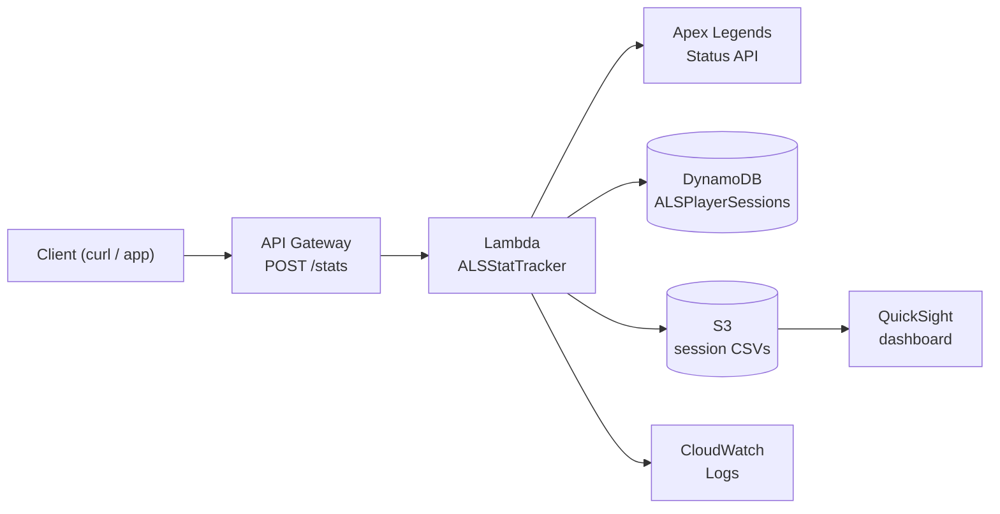

# Apex Legends Stat Tracker

A Python analytics tool for Apex Legends players. It pulls live player stats, then estimates how many games it will take to reach a target rank from a player's session performance and gives a rough read on whether their hidden MMR is ahead of or behind their visible rank. It runs as a local CLI and as a serverless API on AWS.

> Not affiliated with or endorsed by EA or Respawn Entertainment. Player data comes from the community-run [Apex Legends Status API](https://apexlegendsapi.com).

---

## Features

- **Player lookup** by name and platform (PC, PlayStation, Xbox) via the Apex Legends Status API
- **Stat parsing** for account level, total kills and damage, per-legend kills and damage, and current rank, division, and RP
- **Rank predictor** that estimates games needed to reach any target rank from session RP and games played, **including ranked entry costs**
- **MMR estimator** (optional) that compares session performance with expected performance for the player's rank and flags a likely gap
- **Cloud storage** of every session in DynamoDB (queryable) and S3 (CSV, for analytics)
- **Serverless REST API** on AWS Lambda behind API Gateway
- **Dashboard** in Amazon QuickSight built on the S3 data
- **Structured logging** to CloudWatch

---

## Architecture



<!-- Add a screenshot of your QuickSight dashboard to docs/dashboard.png, then uncomment:

-->

| Service | Role |
|---|---|
| **API Gateway** (REST, Lambda proxy) | Public HTTPS endpoint, `POST /stats` |
| **Lambda** (Python 3.14) | Fetches and parses stats, runs the predictor and estimator, writes to storage |
| **DynamoDB** | Session history. Partition key `player_name`, sort key `timestamp` |
| **S3** | One flattened CSV per session at `sessions/<player>/<timestamp>.csv` |
| **QuickSight** | Dashboard over the S3 CSVs, using a manifest file |
| **CloudWatch** | Request-level logs from the Lambda function |

---

## Project structure

```
apex-legends-stat-tracker/
├── ingestion/
│   ├── scrapers/
│   │   └── apex_status_api.py     # API client, parsers, and local CLI entry point
│   ├── analytics/
│   │   ├── rank_predictor.py      # Games-to-rank calculation with entry costs
│   │   └── mmr_estimator.py       # Heuristic MMR vs visible rank estimate
│   └── processors/
│       ├── save_data.py           # Local JSON output
│       ├── dynamo_save.py         # DynamoDB writer
│       └── s3_save.py             # Flattens a session to CSV and writes to S3
├── lambda_handler.py              # AWS Lambda entry point
├── manifest.json                  # QuickSight S3 manifest
├── requirements.txt
└── README.md
```

---

## How the analytics work

### Rank predictor

Every ranked match costs RP to enter, so the prediction uses **net** RP per game:

```
net_rp_per_game = (session_rp - entry_cost × games_played) / games_played
rp_needed       = target_rank_threshold - current_rp
games_needed    = rp_needed / net_rp_per_game      (rounded)
```

Entry cost depends on the player's **current** tier:

| Tier | Entry cost (RP) |
|---|---|
| Rookie | 0 |
| Bronze | 5 |
| Silver | 20 |
| Gold | 35 |
| Platinum | 45 |
| Diamond | 65 |
| Master | 90 |

If net RP per game is zero or negative, the tool says the target can't be reached at the current rate instead of returning a negative number of games.

### MMR estimator

Apex's real MMR is hidden and not exposed by any API. This feature is a **heuristic**: it compares the player's average net RP per game with a rough expected value for their tier. The size of the gap moves the estimate up or down by one or two tiers and sets a confidence label. The expected-value table is hand-tuned, not trained or validated on real match data. Treat the output as a conversation starter, not a measurement.

---

## Getting started (local)

### Prerequisites

- Python 3.10 or newer (developed on 3.14)
- An API key from the [Apex Legends Status API](https://apexlegendsapi.com)
- AWS credentials configured with `aws configure`. The local script also writes to DynamoDB and S3, so it needs the AWS resources below.

### Install

```bash
git clone https://github.com/vishva-r2k/apex-legends-stat-tracker.git
cd apex-legends-stat-tracker
python3 -m venv .venv
source .venv/bin/activate          # Windows: .venv\Scripts\activate
pip install -r requirements.txt
```

### Configure

```bash
export APEX_API_KEY="your-key-here"          # macOS / Linux
# $env:APEX_API_KEY="your-key-here"          # Windows PowerShell
```

The key is read from the environment and is never committed to the repo.

### Run

Run from the project root as a module so the package imports resolve:

```bash
python3 -m ingestion.scrapers.apex_status_api
```

You'll be prompted for a player name (case sensitive), a platform, and the session's RP gained and games played. You can then choose whether to run the rank prediction and the MMR estimate separately.

---

## AWS setup

You need these resources in `us-east-1` (or change the region in the code):

1. **DynamoDB table** `ALSPlayerSessions` with partition key `player_name` (String) and sort key `timestamp` (String), on-demand billing
2. **S3 bucket** for session CSVs. Bucket names are globally unique, so set your own name as `BUCKET_NAME` in `ingestion/processors/s3_save.py`
3. **Lambda function** `ALSStatTracker`
   - Runtime Python 3.14, handler `lambda_handler.lambda_handler`, timeout 30 s
   - Environment variable `APEX_API_KEY`
   - Execution role with DynamoDB and S3 write access
4. **API Gateway REST API** with a `POST /stats` resource using Lambda proxy integration, deployed to a `prod` stage

### Build the Lambda package

`boto3` is already in the Lambda runtime, so leave it out to keep the package small (about 1.4 MB):

```bash
mkdir package
pip install requests -t package/
cp -r ingestion package/
cp lambda_handler.py package/
cd package && zip -r ../lambda_deployment.zip . && cd ..
```

Upload `lambda_deployment.zip` to the function. Every folder under `ingestion/` needs an `__init__.py` or the imports fail inside Lambda.

---

## API usage

**Endpoint:** `POST https://<api-id>.execute-api.us-east-1.amazonaws.com/prod/stats`

| Field | Type | Required | Description |
|---|---|---|---|
| `player_name` | string | yes | Player name (case sensitive) |
| `platform` | string | no | `PC`, `PS4`, or `X1`. Default `PC` |
| `session_rp` | integer | no | Total RP gained this session before entry costs |
| `session_games` | integer | no | Games played this session |
| `target_rank` | string | no | e.g. `Gold`, `Platinum`, `Diamond`, `Masters` |
| `target_div` | string | no | `IV`, `III`, `II`, or `I`. Ignored for Masters |
| `include_mmr_estimate` | boolean | no | Include the MMR estimate. Default `false` |

```bash
curl -X POST https://<api-id>.execute-api.us-east-1.amazonaws.com/prod/stats \
  -H "Content-Type: application/json" \
  -d '{
    "player_name": "ExamplePlayer",
    "platform": "PC",
    "session_rp": 300,
    "session_games": 10,
    "target_rank": "Diamond",
    "target_div": "IV",
    "include_mmr_estimate": true
  }'
```

**Example response** (trimmed):

```json
{
  "player": { "name": "ExamplePlayer", "platform": "PC", "level": 352 },
  "rank": { "rankName": "Silver", "rankDiv": 4, "rankScore": 3250 },
  "prediction": {
    "entry_cost_per_game": 20,
    "avg_gross_rp_per_game": 30.0,
    "avg_net_rp_per_game": 10.0,
    "rp_needed": 8750,
    "games_needed": 875
  },
  "mmr_estimate": {
    "visible_rank": "Silver",
    "estimated_mmr_rank": "Rookie",
    "performance_diff": -12.0,
    "confidence": "Low"
  }
}
```

**Status codes:** `200` success, `400` missing `player_name`, `404` player not found, `500` unexpected error.

---

## Limitations

- **No session data from the API.** The Apex Legends Status API only exposes lifetime stats, so session RP and games played are entered by hand.
- **Hardcoded ranked tables.** RP thresholds and entry costs are constants and need updating when Respawn changes the ranked system.
- **Heuristic MMR estimate.** See above. It is not real MMR.
- **Partial legend stats.** Per-legend kills and damage only appear for legends the API reports tracked data for, and some values come back empty.
- **QuickSight manifest.** `manifest.json` lists specific CSV files. New sessions only appear on the dashboard after the manifest is updated and the dataset is refreshed.
- **Open endpoint.** The API has no authentication or throttling yet.

---

## Roadmap

- Automatic session tracking: an EventBridge schedule snapshots RP so session RP no longer needs manual entry
- Split-reset calculator
- Streak bonus and kill-cap handling in predictions
- API keys and usage plans on API Gateway
- API key moved to AWS Secrets Manager
- Infrastructure as code (AWS SAM or Terraform)
- Automated tests and a GitHub Actions deploy pipeline

---

## Tech stack

Python · requests · boto3 · AWS Lambda · API Gateway · DynamoDB · S3 · QuickSight · CloudWatch
